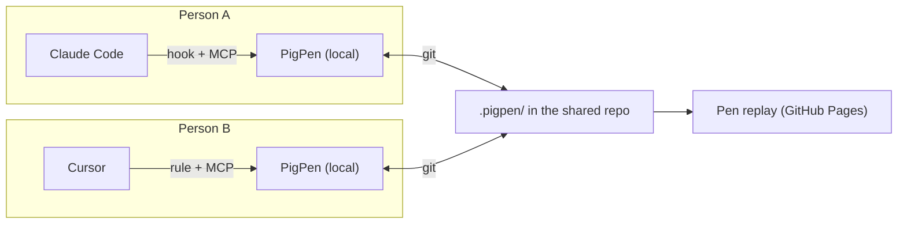

# PigPen

**Clean up AI slop before it happens.** PigPen checks prompts before your agent starts, passes work
between two people's agents through cards a human approves, and keeps receipts of what that saved.
It works across tools: one of you in Claude Code, the other in Cursor, one shared repo.

[](https://github.com/ewc31/PigPen/actions/workflows/ci.yml)
[](./LICENSE)

**▶ [Watch the Pen replay](https://ewc31.github.io/PigPen/)**: a recorded session, in your browser, nothing to install.

<!-- TODO: demo GIF, under 90 seconds -->

> **Status: early demo (v0.1).** The plumbing works; the preflight rules and the replay page are
> being built now. See the [roadmap](#roadmap).

## Why

AI agents are fast and confidently vague. A prompt like "fix it" turns into a large, plausible diff
that's hard to review, and when two people's agents work in one repo, nothing checks what passes
between them. The big tools are adding multiplayer agents, but each one only works inside its own
product. PigPen is a small, open layer that works with both.

## How it works



1. **Preflight.** Every prompt gets a **mud score** from 8 deterministic rules (no model calls, zero
   tokens). Sloppy prompts get up to 3 questions before the agent starts.
2. **Handoff.** When your agent finishes a chunk, it writes a card for your partner's agent. The card
   stays hidden from that agent until a human runs `pigpen approve`.
3. **Receipts.** Every prompt, question, handoff, rerun and revert is logged in `.pigpen/ledger/`,
   including PigPen's own cost.

Full spec: [`docs/pen-format.md`](./docs/pen-format.md).

## Try it

Not on npm yet. You need Node 20+ and pnpm.

```bash
# 1. Build PigPen
git clone https://github.com/ewc31/PigPen.git && cd PigPen
pnpm install && pnpm build

# 2. Put `pigpen` and `pigpen-mcp` on your PATH (run `pnpm setup` once if pnpm asks)
(cd packages/cli && pnpm link --global) && (cd packages/mcp-server && pnpm link --global)

# 3. In the repo you want to use it in
pigpen init && pigpen me a
pigpen preflight "fix it"
```

Then connect your agent: [Claude Code](./integrations/claude-code/README.md) ·
[Cursor](./integrations/cursor/README.md).

## Repo layout

| Path                                           | What                                                                        |
| ---------------------------------------------- | --------------------------------------------------------------------------- |
| [`packages/core`](./packages/core)             | `.pigpen/` format, handoff safety, preflight engine and rules               |
| [`packages/cli`](./packages/cli)               | The `pigpen` command and the Claude Code hook                               |
| [`packages/mcp-server`](./packages/mcp-server) | `pen_preflight`, `pen_brief_read`, `pen_handoff_create`, `pen_handoff_list` |
| [`apps/replay`](./apps/replay)                 | The Pen replay site                                                         |
| [`examples/demo-pen`](./examples/demo-pen)     | The session the replay plays back                                           |
| [`integrations`](./integrations)               | Claude Code and Cursor setup                                                |
| [`docs`](./docs)                               | Spec and guides                                                             |

## Who built what

|              | Owned                                                                                 |
| ------------ | ------------------------------------------------------------------------------------- |
| **Designer (Eileen)** | Pen replay page, brand and design tokens, preflight question wording, terminal output |
| **Engineer (Hakim** | Preflight rules engine and rules, MCP server, hooks, file format                      |

**How this was built.** We used Claude Code and Cursor throughout, and PigPen on itself (see
[`.pigpen/`](./.pigpen)). An agent scaffolded the plumbing: monorepo, CI, file format, MCP server and
CLI. We wrote the preflight rules and the replay page ourselves. [`AGENTS.md`](./AGENTS.md) keeps
agents in a coaching role in those folders.

## Honest limits

- Preflight rules are heuristics. They will miss some sloppy prompts and flag some good ones.
- PigPen sees prompts, briefs and diffs, not the model's reasoning.
- Token savings are only as accurate as what each tool reports; inferred numbers are marked.
- Sync is git only: no live view of the other person's agent yet.

## Roadmap

- [x] `.pigpen/` format, handoff safety, MCP server, CLI, Claude Code hook
- [ ] Preflight rules R1–R8 ([guide](./docs/build-it-yourselves.md))
- [ ] Pen replay with a real recorded session
- [ ] Review against the brief's acceptance criteria
- [ ] A Cursor hook, and a third tool
- [ ] Publish to npm and MCP registries

## License

[Apache-2.0](./LICENSE)
